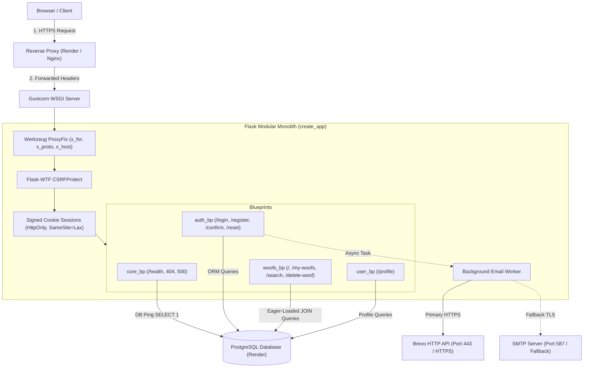
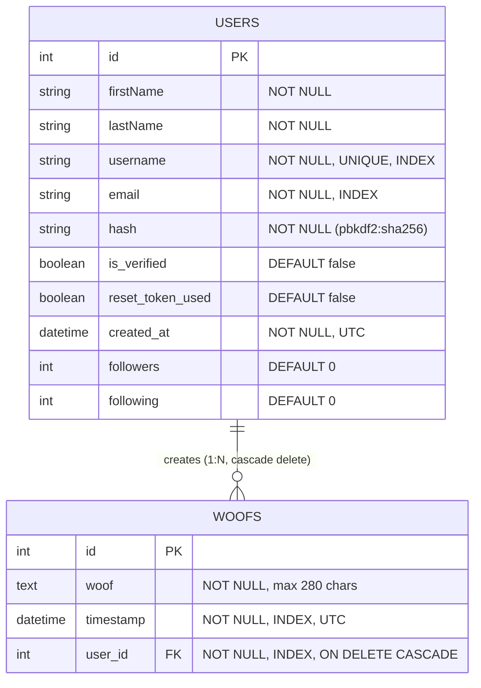

<div align="center">
  <h1>🐶 Woofer — Microblogging Web Platform</h1>
  <p><strong>A modular, production-ready Flask microblogging platform with token authentication, CSRF defense, optimized query plans, Alembic migrations, and automated test coverage.</strong></p>
  <p>
    <a href="https://woofer-rsb9.onrender.com/"><strong>Live Deployment (Render)</strong></a>
  </p>
</div>

---

## 🏛️ System Architecture

Woofer is designed as a modular monolith following Twelve-Factor App principles. It separates domain boundaries across blueprints, exposes an isolated application factory for deterministic testing, and delivers resilient dual-channel email notifications.



---

## 🗄️ Database Entity-Relationship (ER) Diagram



---

## 📊 Key Engineering Optimizations & Benchmarks

| Component | Before Upgrade | After Upgrade | Engineering Benefit |
|---|---|---|---|
| **Feed Query Overhead** | **51 SQL queries** (1 fetch + 50 lazy author queries) | **1 SQL query** (Single `JOIN` via `joinedload(Woof.author)`) | **98% reduction** in database round-trips; eliminates N+1 query burst. |
| **Feed Memory Bounds** | Unbounded table scan (`.all()`) | Constant $O(1)$ memory via paginated window (`per_page=20`) | Prevents out-of-memory worker crashes on large datasets. |
| **Database Migrations** | Manual `db.create_all()` in REPL | Automated **Alembic / Flask-Migrate** version control | Safe, reversible schema evolution in production without downtime. |
| **CSRF Defense** | Completely missing | **Flask-WTF `CSRFProtect`** across all POST forms | Protects against cross-site request forgery attacks. |
| **Automated Testing** | 0 tests | **40 automated pytest tests** (100% pass rate) | Isolated in-memory SQLite and mocked email outbox; zero risk to production data. |
| **Health Check** | `/login` (HTML rendering) | Dedicated **`/health`** returning JSON + real DB ping | True infrastructure readiness indicator; returns 503 if DB is unreachable. |

---

## 🛠️ Technology Stack

- **Backend Framework:** Python 3.12, Flask 2.2.5
- **ORM & Migrations:** Flask-SQLAlchemy 3.1.1, SQLAlchemy 2.x, Flask-Migrate 4.1.0 (Alembic)
- **Database:** PostgreSQL (Render production), SQLite (in-memory test isolation)
- **Security:** Flask-WTF (CSRF protection), itsdangerous (timed HMAC tokens), Werkzeug (password hashing)
- **Email Delivery:** Brevo HTTP API (Port 443 / HTTPS) with SMTP TLS fallback
- **WSGI & Deployment:** Gunicorn 21.2.0, Werkzeug ProxyFix
- **Testing & Quality:** Pytest 9.x, Ruff 0.17.x
- **Frontend:** HTML5, CSS3, JavaScript, Bootstrap 5.3

---

## 🚀 Features

- **Authentication & Security:**
  - Secure registration and login with salt-hashed passwords (`generate_password_hash`).
  - Cryptographically signed email verification tokens (`URLSafeTimedSerializer`).
  - Password reset tokens cryptographically bound to password state (prevents replay attacks).
  - Server-side CSRF validation on all state-changing endpoints.
  - Strict password complexity enforcement ($\ge 8$ chars, uppercase, lowercase, number, symbol).
- **Woofing (Microblogging):**
  - Create woofs with 280-character length bounds and sanitization.
  - Reverse-chronological feed with single-query eager-loaded authors and pagination.
  - Search woofs by keyword, topic, or `@username` with SQL wildcard escaping.
  - View personal post history under `/my-woofs`.
  - Author-only post deletion with strict server-side authorization enforcement.
- **Profile Management:**
  - View personal statistics (total woof count).
  - Secure in-app password update with old password verification.
- **Operations:**
  - Real-time `/health` check with active database validation.
  - Dark mode and responsive UI for desktop and mobile.

---

## ⚙️ Local Setup Guide

### 1. Clone the repository
```bash
git clone https://github.com/ChaitanyaShah21/Woofer.git
cd Woofer
```

### 2. Create and activate a virtual environment
```bash
python3 -m venv .venv
source .venv/bin/activate  # On Windows: .venv\Scripts\activate
```

### 3. Install dependencies
```bash
# Install core and test dependencies
pip install -r requirements-dev.txt
```

### 4. Configure environment variables
Copy `.env.example` to `.env` and configure your local settings:
```bash
cp .env.example .env
```

Example `.env` for local SQLite development:
```env
APP_ENV=development
SECRET_KEY=local-dev-secret-key-32-chars-long
DATABASE_URL=sqlite:///woofer.db
BREVO_API_KEY=your-brevo-api-key-optional
MAIL_SERVER=smtp.gmail.com
MAIL_PORT=587
MAIL_USERNAME=your-email@example.com
MAIL_PASSWORD=your-email-password
MAIL_DEFAULT_SENDER=your-email@example.com
```

### 5. Apply database migrations
```bash
flask db upgrade
```

### 6. Run the application
```bash
python app.py
# Or with Gunicorn:
gunicorn --bind 0.0.0.0:5000 app:app
```
Access the application at `http://127.0.0.1:5000`.

---

## 🧪 Running Automated Tests & Linting

Tests run against an ephemeral in-memory SQLite database and mock all email transmissions into a test outbox. The test suite **never** modifies the production database or calls external network APIs.

```bash
# Run the complete test suite (40 tests)
pytest -v

# Run benchmark verification tests
pytest tests/test_benchmarks.py -v

# Run linting with Ruff
ruff check .
```

---

## 🚀 Deployment on Render

### Web Service Configuration

1. **Runtime:** Python 3
2. **Build Command:**
   ```bash
   pip install -r requirements.txt && flask db upgrade
   ```
3. **Start Command:**
   ```bash
   gunicorn --bind 0.0.0.0:$PORT app:app
   ```
4. **Health Check Path:**
   ```
   /health
   ```

### Environment Variables on Render

| Variable | Description |
|---|---|
| `APP_ENV` | Set to `production` (enables secure cookies and strict security headers) |
| `SECRET_KEY` | Long, cryptographically random secret string |
| `DATABASE_URL` | Internal PostgreSQL connection URL from Render Database service |
| `BREVO_API_KEY` | Brevo API key for transactional email delivery over HTTPS port 443 |
| `MAIL_DEFAULT_SENDER` | Verified sender email configured in your Brevo dashboard |

> **Note on Email on Render Free Tier:** Render blocks outbound SMTP ports (`25`, `465`, `587`) on free tier instances. Configuring `BREVO_API_KEY` routes email delivery through Brevo's HTTP API over HTTPS (port 443), ensuring reliable delivery without SMTP port blocks.

---

## 📐 Key Design Rationales

1. **Why Application Factory over Monolithic Script?**
   Module-level application singletons couple database state to import time. The Application Factory pattern (`create_app`) allows instantiation of multiple isolated application contexts—such as a `TestingConfig` with an in-memory SQLite database—ensuring test independence without polluting production state.

2. **Why Flask-Migrate over `db.create_all()`?**
   `db.create_all()` is blind to existing tables; it cannot add columns, rename fields, or apply database indexes in an existing production schema. Alembic migrations track schema versioning deterministically, enabling safe zero-downtime upgrades and rollbacks.

3. **Why `joinedload` over Default Lazy Loading?**
   The main feed displays author metadata alongside each post. Default lazy loading triggers 1 initial query for posts plus 1 query per post for author lookup ($O(N)$ round-trips). `joinedload` compiles an explicit SQL `JOIN`, fetching all posts and authors in a single round-trip ($O(1)$).

4. **Why Token State Binding for Password Resets?**
   Signing only the user's email allows token replay if multiple reset emails are requested. Binding the signed payload to the current password hash prefix ensures that once a password is changed, any prior tokens are immediately invalidated regardless of expiration window.

---

## 📁 Project Directory Structure

```
Woofer/
├── .github/
│   └── workflows/
│       └── ci.yml               # GitHub Actions CI workflow (linting + pytest)
├── migrations/                  # Alembic schema version migrations
│   ├── versions/
│   │   └── 1992779ec062_*.py    # Initial baseline schema migration
│   ├── env.py
│   └── alembic.ini
├── static/                      # Static assets (CSS, JS, SVG)
│   ├── darkmode.js
│   ├── forms.js
│   ├── home_styles.css
│   ├── styles.css
│   └── woofer.svg
├── templates/                   # Jinja2 HTML templates
│   ├── forgot_password.html
│   ├── home_layout.html
│   ├── index.html
│   ├── layout.html
│   ├── login.html
│   ├── my_woofs.html
│   ├── profile.html
│   ├── register.html
│   ├── resend_verification.html
│   ├── reset_password.html
│   └── search.html              # Post & user search interface
├── tests/                       # Pytest automated test suite
│   ├── conftest.py              # App fixtures & test client setup
│   ├── test_auth.py             # Auth, registration, token tests
│   ├── test_benchmarks.py       # Query count & pagination benchmarks
│   ├── test_health.py           # Health check endpoint tests
│   ├── test_profile.py          # Profile & password change tests
│   ├── test_search.py           # Search & filter tests
│   ├── test_security.py         # CSRF, headers, cookies, XSS tests
│   └── test_woofs.py            # Post creation & delete authorization
├── woofer/                      # Core application package
│   ├── __init__.py              # Application factory (create_app)
│   ├── config.py                # Multi-environment configuration classes
│   ├── extensions.py            # Extension instances (db, mail, csrf, migrate)
│   ├── helpers.py               # Validation & login_required decorator
│   ├── models.py                # SQLAlchemy User and Woof models
│   ├── blueprints/
│   │   ├── auth.py              # Authentication routes
│   │   ├── core.py              # Health check & error handling routes
│   │   ├── user.py              # Profile routes
│   │   └── woofs.py             # Feed, post, search, delete routes
│   └── services/
│       └── email.py             # Dual-engine Brevo HTTP / SMTP email service
├── app.py                       # WSGI entrypoint for Gunicorn and local run
├── helpers.py                   # Backward-compatibility helper re-exports
├── pytest.ini                   # Pytest configuration (pythonpath = .)
├── requirements.txt             # Production dependencies (Render)
├── requirements-dev.txt         # Development & CI test dependencies
└── README.md                    # Recruiter-facing project documentation
```

---

## 📄 License

MIT License.
